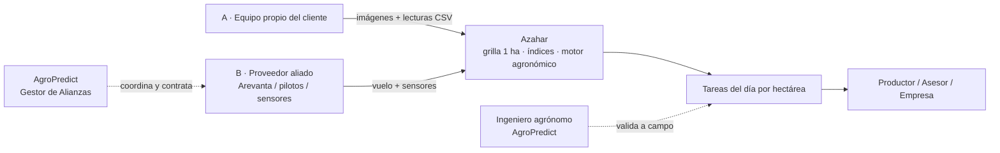
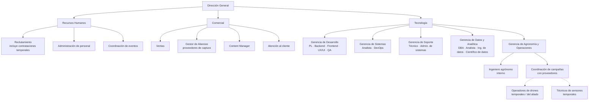

# AgroPredict S.A.S. y Azahar — Documento maestro

*Fuente única de verdad sobre la empresa, el modelo de negocio y el producto. Reemplaza, en lo que se contradigan, a los documentos anteriores. Está pensado para que la landing se arme directamente a partir de él (ver sección 14).*

Grupo 11 · Comisión 4K2 · UTN Facultad Regional Tucumán · Trabajo Final Integrador 2026

---

## 0. Cómo usar este documento

**Jerarquía de fuentes.** Ante cualquier duda, manda este documento. Se construyó así:

| Fuente | Qué se tomó |
|---|---|
| *Idea principal del TFI* (equipo) | Empresa, misión, visión, objetivos, organigrama, **modelo de proveedores**, escalabilidad. Es la base y no se contradice. |
| *Guía: qué hace Azahar* + *ERS de Azahar* | Funcionamiento, indicadores, roles y alcance del software. Se mantienen casi completos. |
| *Guía: qué hace AgroPredict* | Clientes, competencia, FODA, infraestructura y FAQ. Se **adaptaron** las partes que suponían que AgroPredict vuela drones e instala sensores con equipo propio. |

**Tono general.** AgroPredict es una empresa **en etapa de piloto**. El software existe y funciona en modo demostración; los convenios están en gestión y los objetivos están en curso. Nada se presenta como logrado si no lo está.

---

## 1. En una frase

> **AgroPredict** es una startup tucumana de software para agricultura de precisión. Su producto, **Azahar**, le dice al productor citrícola qué atender hoy en su finca, hectárea por hectárea, combinando imágenes de dron, sensores de suelo y conocimiento agronómico del citrus. La captura de datos la hace el propio cliente o un **proveedor aliado** (en primer lugar, **Arevanta**), y AgroPredict la coordina.

**Mensajes clave (en orden de importancia):**

1. Azahar traduce datos en **tareas concretas**: qué hacer, dónde, por qué y cómo.
2. **Especialistas en citrus** de Tucumán; otras economías regionales, próximamente.
3. **No hace falta tener drones**: o traés tus datos, o coordinamos la captura con proveedores especializados en un único paquete de puesta en marcha.
4. **Asesoramiento agronómico incluido** en la suscripción.
5. **Estamos en piloto**: buscamos las primeras fincas para validar Azahar a campo.

---

## 2. Estado actual del proyecto (piloto)

| Área | Qué existe hoy | Qué falta |
|---|---|---|
| Empresa | Definida: S.A.S., misión, visión, objetivos, organigrama objetivo | Constitución formal y primeras contrataciones |
| Azahar | **MVP funcionando en modo demo** sobre lotes reales de Monteros (Finca Santa Lucía) y Famaillá (Finca Don Alberto): carga de shapefiles, grilla de 1 ha, motores espectral y agronómico, roles, mapa | Conectar imágenes reales (GeoTIFF de dron y satélite) y sensores reales; hoy esos datos están **simulados** de forma coherente sobre los lotes reales |
| Proveedores | Arevanta identificado como proveedor principal | **Convenio en gestión**; red de pilotos y sensores en armado |
| Clientes | Programa de **fincas piloto** abierto | Primeros diagnósticos a campo |
| Ecosistema | EEAOC y Clúster Tecnológico identificados como objetivos | Jornadas técnicas, membresía al Clúster |

---

## 3. La empresa

### 3.1 Identidad

- **Nombre:** AgroPredict. Hace referencia a la función insignia del software: anticipar problemas del cultivo para que el productor decida con hechos.
- **Figura legal:** Sociedad por Acciones Simplificada (S.A.S.). Se constituye rápido, pide poco capital inicial y permite sumar inversores más adelante, algo clave para la futura compra de equipo propio (sección 11). Sin CUIT jurídico tampoco se pueden contratar servidores, licencias ni conectividad empresarial, ni aspirar al Clúster Tecnológico.
- **Rubro:** software para el sector agrícola (agricultura de precisión, modelo SaaS).
- **Ubicación:** San Miguel de Tucumán. Zona de trabajo inicial: el pedemonte citrícola tucumano (Famaillá, Monteros, Lules, Tafí Viejo, Burruyacú).

### 3.2 Misión

Brindar herramientas tecnológicas accesibles al productor tucumano para mejorar el control de sus cultivos mediante la agricultura de precisión y un software complementario, facilitando la detección temprana de problemas y optimizando el uso de recursos.

### 3.3 Visión

Liderar la transformación digital del sector agroindustrial de Tucumán, destacándonos por la cercanía con el productor y la facilidad de uso de nuestras herramientas.

### 3.4 Problema que resolvemos

- En el citrus tucumano, el monitoreo fitosanitario y del vigor se hace con **muestreos manuales a pie**: es lento, caro y parcial.
- Cuando un problema se ve a simple vista, **la pérdida ya ocurrió**. Se detectan tarde las anomalías en la hoja y el estrés hídrico.
- La consecuencia es un **uso indiscriminado de fitosanitarios** y más riesgo de mermas, en un cultivo con enfermedades graves como el HLB (de denuncia obligatoria).
- La oferta local de software agropecuario se concentra en **gestión administrativa y contable**; el monitoreo de precisión está prácticamente vacante.

### 3.5 Contexto de mercado

- Los cítricos son el segundo cultivo de Tucumán, solo detrás de la caña de azúcar, y la provincia es la principal productora de limón del país.
- El uso de drones en el agro argentino viene creciendo, y en 2026 aparecieron empresas de servicios agrícolas con drones en otras provincias (como Arevanta en Mendoza). En Tucumán todavía no hay proveedores especializados de este tipo: es una oportunidad y, al mismo tiempo, el motivo por el cual AgroPredict se apoya en aliados externos.
- La regulación acompaña: según el relevamiento del equipo, la ANAC (Res. 550/2025 y enmiendas de 2026) eliminó la licencia de piloto comercial para la Categoría Abierta (vuelo a la vista, hasta 122 m). Se mantienen el registro del dron y el seguro obligatorio para equipos de más de 500 g. Esto facilita contar con pilotos locales acreditados.

---

## 4. Modelo de negocio

### 4.1 Idea central

AgroPredict es una **empresa de software**. Invierte en desarrollar Azahar y **no opera una flota propia** en la primera etapa. La captura de datos en campo (vuelos multiespectrales y sensores) llega por uno de dos caminos:

| Camino | Para quién | Cómo funciona |
|---|---|---|
| **A. Traé tus datos** | Productores o empresas que ya tienen dron multiespectral o sensores | Cargan en Azahar sus imágenes y sus lecturas (CSV). Contratan solo la suscripción. |
| **B. Lo coordinamos nosotros** | Quienes no tienen equipamiento (la mayoría) | AgroPredict coordina la captura con un **proveedor aliado** dentro de un **paquete de puesta en marcha con precio integrado**. |

### 4.2 Oferta comercial

| # | Componente | Qué incluye | Quién lo contrata |
|---|---|---|---|
| 1 | **Diagnóstico inicial** (puerta de entrada) | Relevamiento de una muestra de la finca, reporte de Azahar y visita del agrónomo para recorrer los hallazgos con el productor. Con datos propios, el diagnóstico se hace sobre esos datos y sin vuelo. | Todo cliente nuevo. En la etapa actual, se ofrece dentro del **programa de fincas piloto**. |
| 2 | **Paquete de puesta en marcha** (precio integrado) | Todo el setup inicial en una sola propuesta: vuelo de mapeo multiespectral con proveedor aliado, provisión e instalación de nodos de sensores, alta de lotes en Azahar (desde shapefile, catastro o el propio vuelo), validación a campo del agrónomo y capacitación de los usuarios. | Camino B. El camino A no lo necesita, o lo necesita reducido (solo alta de lotes y capacitación). |
| 3 | **Suscripción a Azahar** | Acceso a la plataforma por establecimiento (escala según superficie), usuarios para productor y asesor, actualizaciones, soporte y **asesoramiento agronómico incluido**: acompañamiento técnico y validación a campo de las alertas críticas. | Todos los clientes. Es el ingreso recurrente principal. |
| — | **Campañas de vuelo adicionales** (opcional) | Vuelos de seguimiento en momentos clave del cultivo (por ejemplo, la brotación, por el psílido del HLB). Se cotizan con el mismo esquema de precio integrado. | Camino B, a demanda. |

**Reglas que hacen coherente el modelo:**

- **Un solo interlocutor y una sola factura.** El cliente le paga a AgroPredict. AgroPredict contrata y le paga al proveedor, y el margen va incluido en el precio integrado. Así se cumple el rol de intermediario de la idea original sin que el cliente tenga que coordinar con varios.
- **AgroPredict no financia vuelos.** El paquete y las campañas se cobran antes de ejecutarse (al menos con una seña), así el costo variable del proveedor nunca sale de la caja de AgroPredict.
- **El diagnóstico se descuenta** del paquete de puesta en marcha si el cliente contrata.
- **Entre vuelos, Azahar no queda ciego**: lo alimentan los sensores (lecturas continuas) y, en la hoja de ruta, imágenes satelitales Sentinel-2 (revisita de unos 5 días). Por eso la suscripción no depende de volar todo el tiempo.
- **Hardware de sensores:** los nodos que se instalan dentro del paquete quedan en la finca del cliente.
- **Precios:** no se publican. Cada finca es distinta (superficie, cantidad de lotes, distancia, si tiene o no equipo propio) y la propuesta se arma después del diagnóstico.

### 4.3 Fuentes de ingreso (resumen)

1. Suscripción a Azahar: recurrente y principal.
2. Paquete de puesta en marcha: único por cliente, con margen sobre los servicios de los aliados.
3. Campañas de vuelo adicionales: eventuales.

El asesoramiento agronómico **no se cobra aparte**: es parte del valor de la suscripción y el principal diferencial frente a plataformas "solo software".

---

## 5. Proveedores y alianzas

### 5.1 Arevanta — proveedor principal

- **Quiénes son:** empresa de Mendoza de servicios agrícolas con drones: fumigación de precisión, **mapeo multiespectral** y monitoreo de cultivos con relevamientos aéreos. Trabaja con equipo propio (DJI Agras y **DJI Mavic 3 Multispectral**) e ingenieros agrónomos propios. Según una entrevista a su director de operaciones (11/08/26), arrancaron con cinco drones y un equipo de nueve personas.
- **Por qué encaja:** su servicio de captura se complementa exactamente con lo que hace Azahar. Ellos generan las imágenes y AgroPredict las convierte en decisiones.
- **Estado:** **convenio en gestión**. No es todavía un socio formal.
- **Cómo se resuelve la distancia (Mendoza–Tucumán):**
  - **Campañas por zona:** se agrupan varias fincas del pedemonte en una misma ventana de fechas para repartir el costo de traslado.
  - **Protocolo común:** se acuerdan los parámetros de vuelo (altura, solapamiento, calibración radiométrica, formato de entrega GeoTIFF) para que las imágenes de cualquier operador entren a Azahar de la misma manera.
  - **A mediano plazo:** pilotos locales que vuelen bajo ese mismo protocolo (5.2).
- Fuente: [entrevista en MDZ](https://www.mdzol.com/dinero/joaquin-llaver-socio-arevanta-con-el-uso-drones-buscamos-solucionarle-un-poco-la-vida-al-productor-n1583799).

### 5.2 Otros proveedores (red en armado)

| Tipo | Rol | Modalidad |
|---|---|---|
| **Pilotos de drones acreditados de la región** | Vuelos de mapeo cuando no conviene traer el equipo de Arevanta | Contratación temporal por campaña, con el protocolo común |
| **Técnicos de instalación de sensores** | Instalan y dan mantenimiento a los nodos de suelo y clima | Contratación temporal por obra |
| **Proveedores de sensores y estaciones meteorológicas** | Hardware de los nodos | Compra por proyecto. Alternativa en evaluación: sensor de humedad de suelo **B01 desarrollado por INTA** |
| **El propio cliente** | Si ya tiene dron multiespectral o sensores | Camino A |

### 5.3 Ecosistema institucional (objetivos, no socios)

| Institución | Relación buscada | Estado |
|---|---|---|
| **EEAOC** (Estación Experimental Agroindustrial Obispo Colombres) | Validación técnica, datos de referencia y participación en jornadas técnicas | Objetivo (estrategias 2.2 y 3.3) |
| **Clúster Tecnológico Tucumán** | Membresía activa, respaldo institucional y rondas de negocios | Objetivo a 8 meses (objetivo 4) |
| **UTN — Facultad Regional Tucumán** | Origen académico del proyecto y vínculo con talento en ingeniería | Proyecto nacido en el marco del TFI |
| **SENASA** | No es una alianza: es la autoridad a la que Azahar indica notificar ante sospecha de HLB | Referencia normativa |

---

## 6. Azahar — el producto

### 6.1 Qué es

Plataforma web (SaaS) de agricultura de precisión para citrus. Toma los lotes de un establecimiento, arma una grilla de **una hectárea** y combina índices multiespectrales, sensores de suelo y clima y modelos agronómicos propios del citrus. El resultado es, para cada hectárea, un **diagnóstico con su evidencia y una recomendación de acción**. El nombre viene de la flor del citrus.

### 6.2 Cómo funciona

1. **Carga de lotes:** shapefile con los sistemas de coordenadas argentinos (POSGAR, Gauss-Krüger fajas 1 a 7), WGS84 y UTM.
2. **Grilla de 1 ha:** unidad mínima de análisis. Es el nivel en el que el productor puede actuar y mantiene liviano el procesamiento.
3. **Índices espectrales por hectárea:** NDVI (vigor), NDRE (clorofila), NDMI (agua en hoja), GNDVI (nitrógeno), EVI y cobertura de copa, sobre una serie histórica de vuelos (en la demo, 12 vuelos cada 14 días).
4. **Sensores:** humedad de suelo a 30 y 60 cm, temperatura, nutrientes y clima, en vivo (en la demo, cada 3 segundos) o cargados por CSV.
5. **Motor agronómico:** reglas propias del citrus que calculan el índice de salud integral (0–100), detectan problemas, estiman el riesgo de plagas, recomiendan riego y predicen la cosecha.
6. **Tareas del día:** lista corta, ordenada por urgencia y conectada con el mapa.

> **Idea clave:** cada hectárea se compara con **un lote sano de la misma especie y edad**, no con un número fijo. Así un lote joven, con menos follaje, no aparece falsamente como enfermo.

**Nota de compatibilidad con el equipo de los aliados.** El DJI Mavic 3 Multispectral captura las bandas verde, rojo, borde rojo e infrarrojo cercano, más una cámara RGB. Con eso Azahar calcula NDVI, NDRE, GNDVI y la cobertura de copa. Los índices que necesitan bandas que el dron no tiene (SWIR para el NDMI, azul para el EVI) se completan con **imágenes satelitales Sentinel-2** y con los **sensores de humedad de suelo**. La resolución de Sentinel-2 (10–20 m) es suficiente para una grilla de 1 ha. Esta integración figura en la hoja de ruta (RFU-01).

### 6.3 Funciones

| Función | Qué hace |
|---|---|
| **Tareas de hoy** | Lista en lenguaje simple con «Hecho», «Ver en el mapa» y «Cómo hacerlo» |
| **Mapa por hectárea** | Capas de salud, agua y riesgo; índices técnicos para el asesor; mapa satelital, híbrido, de calles o de relieve |
| **Diagnóstico** | Estrés hídrico, exceso de agua o posible Phytophthora, deficiencia nutricional, daño por ácaros y clorosis compatible con HLB |
| **Sanidad** | Riesgo de 8 plagas y enfermedades: psílido del HLB, mancha negra, cancrosis, mosca de los frutos, ácaro del tostado, arañuela, Phytophthora y minador |
| **Riego** | Humedad de suelo frente al umbral del cultivo y lámina a reponer en mm |
| **Cosecha** | Lotes listos, fecha estimada de madurez, toneladas esperadas y registro de muestreos |
| **Cartera** | El asesor compara todos los establecimientos de sus clientes |
| **Datos** | Importa lecturas por CSV y exporta zonas de manejo (shapefile), grilla (GeoJSON) y tabla (CSV) |

### 6.4 Usuarios y roles

| Rol | Qué ve y qué hace |
|---|---|
| **Productor** | Solo su establecimiento: tareas, mapa, riego y cosecha. Registra muestreos y carga lecturas |
| **Asesor técnico** | Todos los establecimientos de su cartera; carga lotes, corrige datos y exporta zonas de manejo. Puede ser el agrónomo de AgroPredict o el asesor propio del cliente |
| **Administrador** | Personal de Sistemas de AgroPredict: usuarios, permisos y configuración |

Las contraseñas se guardan cifradas (PBKDF2) y un productor nunca ve los campos de otro. **Los datos son del productor**, que puede exportarlos cuando quiera (Ley 25.326).

### 6.5 Límites (qué NO hace)

- **No diagnostica HLB oficialmente:** detecta una clorosis *compatible* e indica revisar y notificar a **SENASA**.
- **No vuela el dron ni lo comanda:** eso lo hace el operador (aliado o cliente) con el software del fabricante.
- **No comanda riego** ni equipos de aplicación: recomienda, y el productor ejecuta.
- **No hace gestión administrativa ni contable:** complementa a esos sistemas, no los reemplaza.
- **No diagnostica planta por planta:** la unidad es la hectárea.

### 6.6 Real, simulado y preparado

- **Real:** lotes de demo trazados sobre fincas citrícolas reales de Monteros y Famaillá, la grilla, la carga de shapefiles, los usuarios y todo el conocimiento agronómico.
- **Simulado:** las imágenes del dron y las lecturas de los sensores, generadas de forma coherente sobre esos lotes.
- **Preparado:** la capa de captación está desacoplada del análisis. Cuando entren datos reales se reemplaza solo la fuente; el análisis y la interfaz no cambian.

### 6.7 Tecnología (resumen)

Backend en Python con FastAPI y arquitectura limpia; frontend web; mapas con Leaflet o Google Maps; 74 pruebas automáticas; instalable en Windows, en Docker o como ejecutable. Puede funcionar **sin conexión**, salvo el mapa de fondo, algo importante en fincas sin señal. Infraestructura prevista para producción: híbrida, con un servidor propio para recibir y procesar las imágenes crudas y la nube (AWS) para la plataforma de cara al cliente.

---

## 7. Clientes

| Segmento | Qué le resolvemos |
|---|---|
| **Productores citrícolas** (limón, naranja, mandarina, pomelo) | Saber qué lotes necesitan riego, dónde hay un foco sanitario y cuándo cosechar, sin recorrer todo a ciegas |
| **Asesores técnicos y consultoras** | Seguir los establecimientos de varios clientes desde un solo lugar y priorizar recorridas |
| **Empresas citrícolas y empaques** | Información objetiva por hectárea para planificar insumos, cuadrillas y logística de cosecha |
| **Próximamente: otras economías regionales** | Después de validar el modelo en citrus |

También hay una audiencia **del lado de la oferta**: proveedores de servicios con drones y sensores que quieran sumarse a la red.

---

## 8. Competencia y diferencial

- **Competencia indirecta local:** software de gestión administrativa y contable (por ejemplo, SYNAgro). Azahar no busca reemplazarlo, sino complementarlo.
- **Plataformas de precisión nacionales e internacionales:** Auravant, OneSoil y EOS trabajan sobre todo con imagen satelital y cultivos extensivos.
- **Diferencial de AgroPredict:**
  1. **Detalle de dron** (y no solo satélite), con los índices que el dron no cubre completados por satélite y sensores.
  2. **Especialización en citrus** y en el clima tucumano (modelos de plagas, madurez y riego propios del cultivo).
  3. **Tareas, no mapas de colores:** Azahar traduce los índices en qué hacer.
  4. **Agrónomo incluido** que valida a campo.
  5. **Sin inversión en equipo** para el cliente: captura coordinada con aliados en un único paquete.

**FODA (actualizado al modelo con proveedores):**

| Fortalezas | Oportunidades | Debilidades | Amenazas |
|---|---|---|---|
| Especialización en procesamiento de imágenes, IoT y datos | Alianzas con la EEAOC y el Clúster | Empresa nueva, sin cartera de clientes | Sistemas de gestión ya instalados |
| MVP funcionando y validable | Demanda creciente de eficiencia en insumos | **Dependencia de proveedores de captura** (Arevanta está en otra provincia) | Resistencia cultural al cambio |
| Estructura liviana, sin costo de flota | Poca competencia especializada en citrus | Datos de demo aún simulados | Inestabilidad económica y precio del hardware importado |
| Cercanía con el productor tucumano | Crecimiento de los servicios con drones en el país | Mercado local acotado | |

---

## 9. Organización

### 9.1 Organigrama objetivo

### 9.2 Cambios respecto del organigrama original

- **Operadores de drones y técnicos de sensores** dejan de ser personal interno en la primera etapa. Se contratan **temporalmente por campaña** (o los aporta el aliado) y los coordina la Gerencia de Agronomía y Operaciones. Pasan a ser internos recién con la flota propia (sección 11).
- El **ingeniero agrónomo** queda como personal interno: valida diagnósticos, calibra los modelos con observaciones de campo (estrategia 2.3) y da el asesoramiento incluido en la suscripción.
- El **Gestor de Alianzas** (Comercial) gana peso: es el responsable de los convenios con Arevanta y con el resto de la red.

### 9.3 Realidad del piloto

El organigrama describe la **estructura objetivo**. Durante el piloto, los seis socios fundadores cubren varios roles a la vez, y el agrónomo y el personal de campo se suman a medida que entren las fincas piloto.

---

## 10. Objetivos y estado

| # | Objetivo | Estrategias principales | Estado |
|---|---|---|---|
| 1 | MVP funcional en 3 meses | Código abierto (Python, OpenCV), arquitectura escalable, bancos de imágenes con productores | **En curso:** MVP funcionando en demo; falta conectarlo a datos reales |
| 2 | Que Azahar respalde el 90 % de las decisiones del cliente | Alertas tempranas, datos externos (estaciones, EEAOC), validación cruzada a campo | **Pendiente:** requiere fincas piloto |
| 3 | 5 empresas agrícolas tucumanas en 6 meses de operación | Diagnóstico inicial a bajo costo, interfaz para tablet, jornadas de la EEAOC | **Pendiente:** programa de fincas piloto abierto |
| 4 | Membresía en el Clúster Tecnológico Tucumán en 8 meses | Formalización, dos rondas de negocios, presentación del MVP | **Pendiente:** en preparación |

---

## 11. Hoja de ruta

| Fase | Contenido | Estado |
|---|---|---|
| **0 · Base** | Definición de la empresa; MVP de Azahar con lotes reales y datos simulados | Hecho |
| **1 · Piloto** | Convenio con Arevanta; primeras fincas piloto; carga de imágenes reales (GeoTIFF) y sensores reales; validación cruzada a campo con el agrónomo | **En curso** |
| **2 · Lanzamiento comercial** | Suscripciones; imágenes Sentinel-2 automáticas; sensores por LoRaWAN/MQTT; notificaciones push; pronóstico a 7 días; app de recorrida a campo; membresía en el Clúster | Próximo |
| **3 · Escalabilidad** | **Flota propia** (dron multiespectral de referencia: DJI Mavic 3 Multispectral, unos USD 5.500–7.800 según el kit), operadores y técnicos internos, condicionada al ROI y a la base de clientes; **otras economías regionales**; modelos de IA entrenados con imágenes de fincas tucumanas | **Próximamente** |

La flota propia no elimina a los aliados de golpe: suma capacidad, baja la dependencia y permite controlar la calidad de la captura.

---

## 12. Preguntas frecuentes

**¿Necesito tener un dron?** No. Si ya tenés dron multiespectral o sensores, cargás tus datos. Si no, coordinamos la captura con proveedores aliados dentro del paquete de puesta en marcha.

**¿Quién hace los vuelos?** Proveedores especializados, en primer lugar Arevanta (convenio en gestión), y pilotos acreditados de la región que trabajan con nuestro protocolo. Vos hablás solo con AgroPredict.

**¿Cuánto cuesta?** Depende de la superficie, los lotes y si ya tenés equipo. Por eso empezamos con un diagnóstico y después armamos una propuesta con precio integrado.

**¿Azahar detecta el HLB?** No lo diagnostica: detecta una pérdida de clorofila localizada y compatible con HLB, te indica revisar las plantas y, si hay síntomas, notificar a SENASA, porque es de denuncia obligatoria.

**¿En qué se diferencian de Auravant u otras plataformas?** Detalle de dron, especialización en citrus, tareas concretas en lugar de mapas para interpretar y un agrónomo incluido que valida a campo.

**¿Funciona en fincas sin señal?** Sí. Las imágenes se descargan en el campo y se procesan después; Azahar puede usarse sin conexión, salvo el mapa de fondo.

**¿De quién son los datos?** Del productor. Cada usuario ve solo lo suyo y puede exportarlo cuando quiera.

**¿Por qué una hectárea y no cada planta?** Porque es el nivel en el que se puede actuar (regar un sector, revisar un foco) y mantiene el sistema liviano.

**¿Ya están operando?** Estamos en etapa de piloto: Azahar funciona y buscamos las primeras fincas para validarlo a campo con datos reales.

---

## 13. Qué NO decir (en la landing ni en la presentación)

| ❌ No decir | ✅ Decir |
|---|---|
| "Volamos tus lotes", "nuestra flota", "nuestros drones" | "Coordinamos la captura con proveedores aliados" |
| "Nuestros socios: Clúster, EEAOC" | "Ecosistema con el que buscamos trabajar" y su estado |
| "Arevanta, nuestro socio" | "Arevanta, proveedor principal — convenio en gestión" |
| "90 % de las decisiones respaldadas", "monitoreo 24/7" | Objetivos expresados como metas del piloto |
| "Visión artificial / IA que detecta plagas" | "Motor agronómico propio del citrus"; la IA entrenada va en la hoja de ruta |
| "Diagnosticamos HLB" | "Detectamos clorosis compatible con HLB" |
| "Notificaciones push", "pronóstico del tiempo" como si ya existieran | Hoja de ruta |
| Caña, granos u hortalizas como servicios actuales | "Próximamente, otras economías regionales" |
| Precios | "Pedí tu diagnóstico" |

---

## 14. Guía de contenido para la landing

Orden de secciones y textos listos para usar.

| # | Sección (ancla) | Contenido |
|---|---|---|
| — | **Navegación** | Azahar · Cómo funciona · Proveedores · Quiénes somos · Preguntas. Botón: **Pedí tu diagnóstico** |
| 1 | **Hero** (`#top`) | Eyebrow: *Agricultura de precisión para citrus · Tucumán*. Título: **Sabé qué atender hoy en tu finca, hectárea por hectárea.** Bajada: *Azahar, la plataforma de AgroPredict, combina imágenes de dron, sensores de suelo y conocimiento agronómico del citrus para convertir datos en tareas concretas. No necesitás tener drones: la captura la coordinamos con proveedores especializados.* Botones: *Pedí tu diagnóstico* / *Conocé Azahar*. Panel "vista demo": Finca Santa Lucía, Monteros · Salud integral 78/100 · Riesgo psílido: moderado · 3 tareas hoy. Etiqueta: *Programa de fincas piloto abierto* |
| 2 | **Problema** (`#problema`) | *Cuando se ve, ya es tarde.* Tres tarjetas: monitoreo a pie (lento y parcial), detección tardía (la pérdida ya ocurrió) y aplicaciones a ciegas (uso indiscriminado de fitosanitarios) |
| 3 | **Azahar** (`#azahar`) | *De los datos a la tarea del día.* Seis funciones (6.3) y tres datos: **1 ha** unidad de análisis · **8** plagas y enfermedades modeladas · **0–100** índice de salud integral. Aviso de estado: demo con lotes reales y datos simulados; en el piloto se conecta a datos reales |
| 4 | **Cómo funciona** (`#como`) | Tres pasos: Captura → Análisis → Decisión. Dos caminos: *Traé tus datos* / *Lo coordinamos nosotros* (4.1) |
| 5 | **Cómo empezar** (`#empezar`) | Diagnóstico inicial → Puesta en marcha (precio integrado) → Suscripción con asesoramiento incluido. *No publicamos precios: cada finca es distinta.* |
| 6 | **Proveedores** (`#proveedores`) | Arevanta destacado (convenio en gestión) + pilotos acreditados de la región + proveedores de sensores. CTA: *¿Brindás servicios con drones o sensores en el NOA? Sumate a la red* |
| 7 | **Para quién** (`#clientes`) | Productores citrícolas · Asesores y consultoras · Empresas citrícolas y empaques · Próximamente: otras economías regionales |
| 8 | **Quiénes somos** (`#quienes`) | Startup tucumana en piloto, misión, visión, ecosistema con estado (EEAOC, Clúster, UTN FRT) |
| 9 | **Hoja de ruta** (`#ruta`) | Las cuatro fases de la sección 11, con su estado; flota propia como *Próximamente* |
| 10 | **Preguntas** (`#faq`) | Sección 12 |
| 11 | **Contacto** (`#contacto`) | *Pedí tu diagnóstico.* Formulario: nombre, email, perfil (productor / asesor / empresa / proveedor), especie, ¿tenés dron o sensores?, superficie aproximada y mensaje |
| — | **Footer** | AgroPredict S.A.S. (en formación) · San Miguel de Tucumán · Proyecto en etapa de piloto · TFI UTN FRT |

**Pendiente visual:** el logo actual muestra una planta de caña de azúcar y la foto del hero es un viñedo. Para ser coherentes con el foco en citrus conviene reemplazar ambos (por ejemplo, un dron sobre un brote o una flor de azahar, y una foto de una finca de limoneros al pie del cerro).

---

## 15. Trazabilidad de cambios respecto de los documentos anteriores

| Documento anterior | Decía | Ahora |
|---|---|---|
| Qué hace AgroPredict | Cuatro servicios propios: vuelos, sensores, plataforma y asesoramiento | Software propio + captura **coordinada con aliados**; asesoramiento **incluido** en la suscripción |
| Qué hace AgroPredict | Ingresos: vuelo de diagnóstico, suscripción, monitoreo con vuelos cada 14 días, asesoramiento | Diagnóstico inicial + **paquete de puesta en marcha con precio integrado** + suscripción (+ campañas opcionales) |
| Qué hace AgroPredict | Debilidad: "dependencia de hardware importado" | "Dependencia de proveedores de captura" |
| Idea principal | Producto llamado "Plataforma AgroPredict" | Empresa **AgroPredict**, producto **Azahar** |
| Idea principal | Operadores y técnicos en el organigrama | Temporales o del aliado en la primera etapa; internos con la flota propia |
| Idea principal | "Modelo de negocio final aún no definido" | Definido en la sección 4, con la flota propia como fase 3 |
| Guía de Azahar / ERS | NDMI y EVI con bandas del dron | Completados con Sentinel-2 y sensores (el Mavic 3M no tiene SWIR ni azul) |
| ERS | "Imágenes de los operadores de drones" al servidor local | Imágenes del aliado o del cliente |
| Landing anterior | Caña, granos y hortalizas; socios institucionales; 90 % y 24/7; visión artificial | Citrus + próximamente; ecosistema con estado; metas del piloto; motor agronómico |
